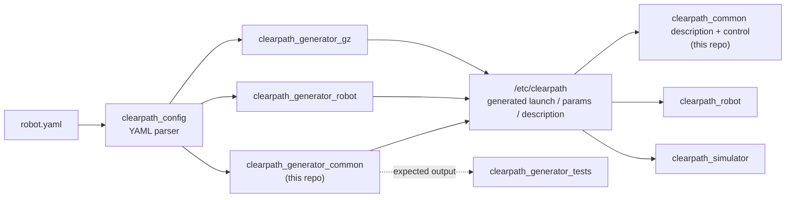

# clearpath_common

ROS 2 common packages for Clearpath Robotics platforms.

This repository provides the core platform bringup, control, diagnostics, robot description assets, and generator utilities used across Clearpath robotic platforms.

For supported platforms, sensors and manipulators plus additional details, please see:
<https://docs.clearpathrobotics.com/docs/ros/>

## Where this fits in the Clearpath ROS 2 stack

`clearpath_common` holds the platform-agnostic building blocks shared by both real robots
(`clearpath_robot`) and simulation (`clearpath_simulator`): the URDF descriptions, controllers,
diagnostics, and — importantly — the **common generator** that turns a parsed `robot.yaml` into
launch/description output.



`clearpath_generator_common` is the shared generator base: `clearpath_generator_robot` and
`clearpath_generator_gz` build on it. Its generators and templates live under
[`clearpath_generator_common/clearpath_generator_common`](clearpath_generator_common/clearpath_generator_common)
and produce bash environment setup, robot description (URDF/xacro), the discovery server config,
and the manipulator SRDF.

## Packages

- `clearpath_common`: Metapackage for core common stack.
- `clearpath_bt_joy`: Bluetooth joystick watchdog. Monitors HID report-rate on `/dev/hidrawN` and publishes a stop flag when link quality drops below threshold. Only for PS5 at the moment.
- `clearpath_control`: Platform controllers, localization, and teleoperation launch files.
- `clearpath_customization`: Templates and generators for project bringup/description customization.
- `clearpath_description`: Clearpath URDF descriptions metapackage.
- `clearpath_diagnostics`: Diagnostic updater and aggregator launch/config.
- `clearpath_generator_common`: Common Python generator utilities and templates.
- `clearpath_manipulators`: Manipulator integration package.
- `clearpath_manipulators_description`: Manipulator description assets.
- `clearpath_mounts_description`: Mount description assets.
- `clearpath_platform_description`: Common platform meshes, URDF, and description launch.
- `clearpath_sensors_description`: Sensor description assets.

## Requirements

- Ubuntu with ROS 2 installed.
- `colcon` and standard ROS 2 build tools.
- A robot setup directory at `/etc/clearpath` (or a custom `setup_path`) for runtime configuration files. For more details, see [docs.clearpathrobotics.com](https://docs.clearpathrobotics.com/).

## Build

From your ROS 2 workspace root:

```bash
rosdep install --from-paths src --ignore-src -r -y
colcon build --symlink-install
source install/setup.bash
```

## Mock Hardware

Launch the platform and configured manipulators using mock hardware instead of physical
drivers:

```bash
ros2 launch clearpath_mock_hardware mock.launch.py
```

The setup directory defaults to `~/clearpath/` and must contain `robot.yaml`. To use a
different setup directory:

```bash
ros2 launch clearpath_mock_hardware mock.launch.py setup_path:=/path/to/mock_setup
```

The launch file runs the common description and semantic-description generators, then the
mock launch and parameter generators before including the generated platform, manipulator,
sensor, and platform-extras service launch files. Mock hardware uses wall time; no Gazebo
simulator or simulation clock is required. Sensors are not mocked yet.

Manipulators configured in `robot.yaml` are brought up automatically with mock hardware
and their configured controllers under `<namespace>/manipulators`. MoveIt is started only
when enabled in the manipulator configuration. For example, check the arm controllers with:

```bash
ros2 control list_controllers -c /<namespace>/manipulators/controller_manager
```

Generation replaces generated files in the selected setup directory. Use a separate setup
directory from a physical robot. To launch previously generated mock files without regenerating:

```bash
ros2 launch clearpath_mock_hardware mock.launch.py generate:=false
```

### Mock platform integration tests

The `clearpath_mock_hardware` package registers nine `launch_testing` integration tests:
DD100, DD150, DO100, DO150, J100, A200, A300, R100, and W200. Each uses the default
drivetrain with no manipulators or sensors. The `generic` platform is intentionally
excluded: its empty description defines no drivetrain hardware and does not satisfy
the physical-platform controller contract. A coverage assertion detects new platform
entries that need to be added to the matrix.

After building and sourcing the workspace, run:

```bash
colcon test --packages-select clearpath_mock_hardware --event-handlers console_direct+
colcon test-result --verbose
```

To run just one platform:

```bash
colcon test --packages-select clearpath_mock_hardware \
  --ctest-args -R '^test_mock_a200$' --output-on-failure
```

Each test writes a minimal `setup/robot.yaml` under a unique
`build/clearpath_mock_hardware/test_runs/<platform>-<unique-id>/` directory and includes
the installed `mock.launch.py` with `setup_path` pointing there and `generate:=true`.
The entry point runs description, semantic-description, mock launch, and mock parameter
generation before bringing up the generated services. No generators or controller
processes are substituted with test doubles.

The active test waits up to 90 seconds for generation and startup, then checks controller
types and activation, the active `mock_components/GenericSystem` backend, claimed wheel
interfaces, wall-time parameters, and sustained finite wheel velocity state publication.
It also checks generated artifacts and generator/spawner completion. Post-shutdown
checks verify that all tracked processes terminate without unexpected exit codes.

Tests run serially and use the standard `ament_cmake_ros` isolated runner to allocate
a ROS domain shared by the test client and launched nodes. As with other ROS isolated
tests, an explicitly exported `ROS_DOMAIN_ID` or `DISABLE_ROS_ISOLATION` overrides automatic
domain allocation; leave both unset for isolated runs. Each run also has its own
`ROS_HOME` and ROS log directory. Successful run directories are removed after shutdown;
failed setups and logs are retained at the path printed in the test output. Test results
remain in the package's build directory. Neither the source configuration nor
`~/clearpath/` is modified.

### Velocity limit integration tests

The velocity integration tests are disabled by default to keep ordinary `colcon test`
runs short. The platform bringup tests and fast velocity-helper pytest tests remain
enabled. To register and run the velocity tests, enable the CMake option when building:

```bash
colcon build --packages-select clearpath_mock_hardware \
  --cmake-force-configure --cmake-args -DCLEARPATH_MOCK_VELOCITY_TESTS=ON
colcon test --packages-select clearpath_mock_hardware \
  --ctest-args -R '^test_mock_velocity_' --output-on-failure
```

The option is cached in the build directory, so subsequent ordinary test runs also
include the velocity tests until it is disabled again:

```bash
colcon build --packages-select clearpath_mock_hardware \
  --cmake-force-configure --cmake-args -DCLEARPATH_MOCK_VELOCITY_TESTS=OFF
```

Existing test result files from an earlier enabled run may still appear in
`colcon test-result` after the option is disabled.

The nine `test_mock_velocity_<platform>` tests cover DD100, DD150, DO100, DO150,
J100, A200, A300, R100, and W200 using their default drivetrains. They reuse the same
platform launch, readiness, and shutdown checks, with a shared `velocity_checks.py`
helper. A test-side
`rclpy` node publishes freshly stamped `TwistStamped` commands at 50 Hz and subscribes
to the controller's raw `platform/odom` topic. Node-specific remappings route the
controller's command input to `platform/test_cmd_vel`, bypassing the normal twist mux.
The test verifies that it is the only publisher on that isolated input; no command-line
topic tools or physical hardware are used.

Differential-drive platforms exercise linear X and angular Z; the mecanum platforms
DO100, DO150, and R100 exercise linear X/Y and angular Z.
Each axis checks 40%-of-limit tracking, positive and negative saturation using requests
at 150% of the bound, and return to rest when command publication stops. Generated and
running velocity limits, acceleration settings, and command timeouts are checked against
independent expectations for the shipped defaults. Differential-drive feedback odometry
is explicitly required (`open_loop=false`). W200 uses velocity feedback
(`position_feedback=false`) and a 0.25-second command timeout; other differential-drive
platforms use 0.5 seconds. Mecanum controllers use a 0.1-second reference timeout.

Measurements must have finite values and fresh, advancing timestamps. Tracking requires
at least five samples spanning 0.3 seconds, within an absolute tolerance of 0.02 plus
3% of the expected target. The settling window is time-based so it works at both
20 Hz and 50 Hz odometry rates; synthetic pytest regressions cover both rates.
Saturation additionally checks that measured velocity never
exceeds the configured bounds beyond 0.02 plus 3% of the largest bound. Each scenario
starts and finishes at rest, and settling deadlines allow for the configured acceleration
and odometry filtering. Timeout scenarios stop publication without sending a zero command;
their stop deadline allows the target/acceleration ramp time plus two seconds.
Acceleration slopes, jerk limits, combined-axis behavior, non-default drivetrain
variants, and manipulators are not tested yet.

On failure, the retained run directory contains `velocity_trace.csv`, recording the
scenario, commands, expected velocities, odometry velocities, and timestamps alongside
the generated setup and ROS logs. Cleanup attempts to publish zero and verify rest before
destroying the test node. The nine velocity tests take approximately 5 minutes 21 seconds
together on the development machine (23-44 seconds per platform); the package suite
with velocity tests enabled takes approximately 6 minutes 7 seconds. Each velocity launch test has a
240-second overall timeout.

## Generator Tests

Changes to the generators in this repository (`clearpath_generator_common`) may affect the
generated output for launch files, parameter files, and descriptions. The
[clearpath_generator_tests](https://github.com/clearpathrobotics/clearpath_generator_tests)
repository versions the expected output and validates it through CI.

Before merging, ensure a corresponding branch with the **same name** exists in
`clearpath_generator_tests` with regenerated samples. See the
[Development Workflow](https://github.com/clearpathrobotics/clearpath_generator_tests#development-workflow)
section of `clearpath_generator_tests` for the full process.

## Documentation

- [Generators](https://docs.clearpathrobotics.com/docs/ros/config/generators) — how `clearpath_generator_common` turns `robot.yaml` into bash/description/launch/param files.
- [Robot YAML overview](https://docs.clearpathrobotics.com/docs/ros/config/yaml/overview) — the input configuration format.
- [Clearpath ROS 2 documentation](https://docs.clearpathrobotics.com/docs/ros/) — full platform documentation.

## License

BSD. See [LICENSE](LICENSE).
